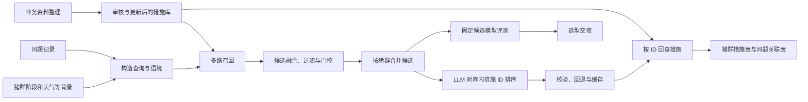

# 架构与数据流

## 工作流

## 关键设计

1. **知识作为候选边界**：措施文本从当前知识库回查；排序模型负责排列已有 ID，不应添加库外措施。
2. **多路召回与融合**：稠密向量、BM25、精确业务匹配及规则通道提供候选，再按配置融合、过滤和门控。
3. **猪群级排序**：同一猪群的多个问题可能关联同一措施。候选按措施 ID 合并后统一排序，再保留与各问题的关联。
4. **受限输出与回退**：对未知、重复、缺失或异常的 ID 做校验；不完整结果可按规则补齐，异常时走规则回退。
5. **可复用计算**：运行期和跨天缓存按输入、知识及配置版本构成指纹；校验不通过时重新计算。
6. **评测与召回解耦**：模型替换实验固定原始输入和候选，比较精排顺序；K1 只在固定候选后按候选关联追加参考知识，不改变原召回通道。

图示概括的是已审阅快照中的链路，不声明所有外部调用都使用同一知识版本，也不代表线上部署图。

